# Comprehensive Technical Audit: Multi-Store Footwear Sizing Architecture, Variant Combinatorial Collision, and Delta Stock Parity Discrepancies

**Audit Document**: `docs/audits/FOOTWEAR_SIZING_AND_STOCK_PARITY_AUDIT.md`  
**Target Storefront**: *The Rare Avenue* (`https://therareavenue.com/` / `hewmvw-am.myshopify.com`)  
**Live Theme**: Prestige OS 2.0 (Theme ID: `197348655270`)  
**Audit Date**: October 7, 2026  
**Audited Repositories**:
- Primary: `c:\Users\Administrator\WorkPlace\dropship-scraper-portable-20260905\product-updater`
- Scraper: `c:\Users\Administrator\WorkPlace\dropship-scraper-portable-20260905\dropship-scraper`

---

## 1. Executive Summary

This comprehensive audit investigates two critical customer-facing issues reported on *The Rare Avenue* storefront regarding footwear products:

1. **The Dual-Size Option Trap ("The Matching Game")**: Shoe product display pages (PDPs) present two separate, independent option selectors (`Size (US)` and `Size (UK)`). Because physical shoes map 1:1, selecting any US size without simultaneously matching the exact corresponding UK size creates an invalid Cartesian variant node in Shopify, rendering an `"UNAVAILABLE"` state and disabling the `"ADD TO BAG"` button.
2. **Variant Stock Parity Discrepancy**: Live retailer stock on the source store (e.g., JD Sports showing *Women's Nike Air Force 1 '07 Casual Shoes - Sail/Rose Gold* with only sizes 6.0, 6.5, and 11.0 active) directly contradicts live Shopify inventory (which shows sizes 7.0 and 8.5 available, while sizes 6.0, 6.5, and 11.0 are unavailable).

### Key Audit Findings:
- **Scope of Affected Products**: Exactly **1,021 footwear products** (100% of athletic footwear in the catalog across Nike, Jordan, adidas, ASICS, HOKA, Salomon, and On Running) suffer from the dual-size option defect:
  - **JD Sports**: 476 products
  - **Foot Locker**: 307 products
  - **Nordstrom**: 238 products
- **Designer Footwear is Unaffected**: Luxury designer footwear from **COACH** (159 shoe models) and **Michael Kors** (174 shoe models) were already modeled with a clean single option dimension (`Size`), using unified labels (`US {us} / UK {uk}`).
- **Root Cause of Stock Parity Divergence**:
  - The local database record for the Nike AF1 was last verified on **September 20, 2026** (16 days stale).
  - When the freshner daemon executes, JD Sports encounters Akamai Bot Protection (HTTP 403 / "rate_limited").
  - In `storage/rate_limiter.py`, `_CONSECUTIVE_THROTTLES["jdsports"]` is held in memory across cycles. Failure on item #1 immediately trips the store circuit breaker (1200s cooldown), aborting the sweep for all remaining 475 JD Sports items.
  - On October 4, `scripts/shopify_bulk_uploader.py` synced local JSON files to Shopify Admin GraphQL, pushing the frozen September 20 stock snapshot to the live storefront.

---

## 2. Cross-Store Sizing Architecture Matrix

Every store partition across `product-updater` was audited for variant option modeling and freshner health:

| Retailer / Store Slug | Total Products | Footwear / Multi-Size | Sizing Option Architecture | Option Dimensions Generated | Shopify Status | Freshner Engine | Live Parity Health |
| :--- | :---: | :---: | :--- | :--- | :---: | :--- | :--- |
| **`jdsports`** | 476 | 476 (100%) | **Dual-Option Defect** | `['Size (US)', 'Size (UK)', 'Color']` | 476 / 476 | Camoufox | 🔴 **CRITICAL**: Stale since Sep 20; breaker halts sweep on item 1 |
| **`footlocker`** | 307 | 307 (100%) | **Dual-Option Defect** | `['Size (US)', 'Size (UK)', 'Color']` | 307 / 307 | HTTP (`STATE_FROM_SERVER`) | 🟢 **ACTIVE**: HTTP polling operational; variant parser active |
| **`nordstrom`** | 238 | 238 (100%) | **Dual-Option Defect** | `['Size (US)', 'Size (UK)', 'Color']` | 238 / 238 | Camoufox + Fast Path | 🟡 **DEGRADED**: Kasada blocks PDPs; fast-path omits child variant diffs |
| **`coach`** | 573 | 159 (27.7%) | **Clean Single Option** | `['Size']` (Shoes), `['Color']` (Bags) | 573 / 573 | HTTP / curl_cffi | 🟢 **HEALTHY**: Scene7 / JSON-LD live parsing active |
| **`michaelkors`** | 530 | 174 (32.8%) | **Clean Single Option** | `['Size', 'Color']` (Shoes/Belts) | 530 / 530 | SFCC Demandware AJAX | 🟢 **HEALTHY**: SFCC variationAttributes active |
| **`jwpei`** | 491 | 0 (Bags) | **N/A** (Single Option) | `['Color']` | 491 / 491 | Shopify `.js` endpoint | 🟢 **HEALTHY**: 100% reliable 60m polling |
| **`jomashop`** | 574 | 0 (Watches) | **N/A** (Single Option) | `['Case Diameter']` | 574 / 574 | HTTP JSON-LD | 🟢 **HEALTHY**: Continuous watch sync |
| **TOTAL** | **3,189** | **1,354** | — | — | **3,189 / 3,189** | — | **1,021 Footwear Items Require Option Unification** |

---

## 3. Deep Root Cause Analysis: Issue 1 — The Dual-Size Option Trap

### 3.1 Code-Level Origin of the Dual Options
In all three athletic footwear inflow normalizers, sizing was implemented as two separate option dimensions:

1. **`stores/jdsports/inflow.py` (lines 623–628, 651–664)**:
   ```python
   "option_values": [
       {"option_name": "Size (US)", "name": s["size_label"]},
       {"option_name": "Size (UK)", "name": f"UK {s['uk_str']}"},
       {"option_name": "Color", "name": color or "Standard"}
   ]
   product_options = [
       {"name": "Size (US)", "values": [{"name": s["size_label"]} for s in deduped_sizes]},
       {"name": "Size (UK)", "values": [{"name": f"UK {s['uk_str']}"} for s in deduped_sizes]},
       {"name": "Color", "values": [{"name": color or "Standard"}]}
   ]
   ```

2. **`stores/footlocker/inflow.py` (lines 338–343, 372–385)**:
   ```python
   "option_values": [
       {"option_name": "Size (US)", "name": f"US {s['us_str']}"},
       {"option_name": "Size (UK)", "name": f"UK {s['uk_str']}"},
       {"option_name": "Color", "name": color or "Standard"}
   ]
   ```

3. **`stores/nordstrom/inflow.py` (lines 490–495, 518–531)**:
   ```python
   "option_values": [
       {"option_name": "Size (US)", "name": f"US {us_str}"},
       {"option_name": "Size (UK)", "name": f"UK {res_uk}"},
       {"option_name": "Color", "name": c_name}
   ]
   ```

4. **Dynamic Normalizer in `storage/shopify_taxonomy.py` (lines 620–633)**:
   ```python
   ordered_dim_names: List[str] = []
   for v in variants_raw:
       ovs = v.get("option_values")
       if isinstance(ovs, list) and len(ovs) > 0:
           for ov in ovs:
               raw_name = ov.get("option_name") or ""
               clean_name = "Color" if raw_name.strip() in ("Color", "Colour") else raw_name.strip()
               if clean_name and clean_name not in ordered_dim_names:
                   ordered_dim_names.append(clean_name)
   ```
   Because both `"Size (US)"` and `"Size (UK)"` exist in each variant record, `ordered_dim_names` evaluates to `["Size (US)", "Size (UK)", "Color"]`, establishing a 3-option schema for Shopify GraphQL `productSet`.

### 3.2 The Mathematical & Front-End Collision
- **Cartesian Space Explosion**:
  $$\text{Cartesian Space} = |\text{Size (US)}| \times |\text{Size (UK)}| \times |\text{Color}| = 15 \times 15 \times 1 = 225 \text{ possible combinations}$$
- Because a single physical shoe has an immutable 1:1 mapping ($f(\text{US}) \mapsto \text{UK}$), **only 15 variants are ever created**. The remaining **210 combinations do not exist in Shopify**.
- **Front-End DOM Breakdown (`theme/snippets/variant-picker.liquid` & `theme.js`)**:
  - The storefront template iterates over `product.options_with_values`, rendering two independent radio pill containers: `Size (US)` and `Size (UK)`.
  - When a shopper clicks `US 8.5` in Block 1, Block 2 remains on whatever UK size was previously active (e.g., `UK 4.5`).
  - The theme executes its JavaScript variant lookup:
    ```javascript
    selectedVariant = product.variants.find(v => v.options[0] === 'US 8.5' && v.options[1] === 'UK 4.5');
    ```
  - Because `(US 8.5, UK 4.5)` is non-existent, `selectedVariant` evaluates to `null`.
  - The theme displays `"UNAVAILABLE"` and completely disables the `"ADD TO BAG"` button.
- **Why UK Sizes Appeared "Not Tracked for Stock"**:
  Stock policies (`inventoryPolicy: "CONTINUE"` vs `"DENY"`, `inventoryQuantity`) attach to the **Variant node** in Shopify, not to option strings. Because mismatching options produces `null`, the buyer experiences a UI deadlock that appears as though UK sizes are untracked.

---

## 4. Deep Root Cause Analysis: Issue 2 — Stock Parity Discrepancy

### 4.1 Case Study: Women's Nike Air Force 1 '07 - Sail/Rose Gold

Comparing the live source page on `jdsports.com` against the local database (`storage/db/jdsports/products/429f293ceb4ff848.json`) and live Shopify Admin (`gid://shopify/Product/15851448991910`):

| Variant | Source Website (`jdsports.com`) | Local Database (`429f293ceb4ff848.json`) | Live Shopify Storefront | Discrepancy Nature |
| :--- | :--- | :--- | :--- | :--- |
| **US 5.0 / UK 2.5** | Slashed (Out of Stock) | `in_stock: false` | `availableForSale: False` | Match |
| **US 5.5 / UK 3.0** | Slashed (Out of Stock) | `in_stock: false` | `availableForSale: False` | Match |
| **US 6.0 / UK 3.5** | **ACTIVE (IN STOCK)** | `in_stock: false` | `availableForSale: False` | **False Out of Stock (Lost Revenue)** |
| **US 6.5 / UK 4.0** | **ACTIVE (IN STOCK)** | `in_stock: false` | `availableForSale: False` | **False Out of Stock (Lost Revenue)** |
| **US 7.0 / UK 4.5** | Slashed (Out of Stock) | `in_stock: true` | `availableForSale: True` | **Ghost Stock (Oversell Risk — Unfulfillable)** |
| **US 7.5 / UK 5.0** | Slashed (Out of Stock) | `in_stock: false` | `availableForSale: False` | Match |
| **US 8.0 / UK 5.5** | Slashed (Out of Stock) | `in_stock: false` | `availableForSale: False` | Match |
| **US 8.5 / UK 6.0** | Slashed (Out of Stock) | `in_stock: true` | `availableForSale: True` | **Ghost Stock (Oversell Risk — Unfulfillable)** |
| **US 9.0 / UK 6.5** | Slashed (Out of Stock) | `in_stock: false` | `availableForSale: False` | Match |
| **US 9.5 / UK 7.0** | Slashed (Out of Stock) | `in_stock: false` | `availableForSale: False` | Match |
| **US 10.0 / UK 7.5** | Slashed (Out of Stock) | `in_stock: false` | `availableForSale: False` | Match |
| **US 10.5 / UK 8.0** | Slashed (Out of Stock) | `in_stock: false` | `availableForSale: False` | Match |
| **US 11.0 / UK 8.5** | **ACTIVE (IN STOCK)** | `in_stock: false` | `availableForSale: False` | **False Out of Stock (Lost Revenue)** |
| **US 11.5 / UK 9.0** | Slashed (Out of Stock) | `in_stock: false` | `availableForSale: False` | Match |
| **US 12.0 / UK 9.5** | Slashed (Out of Stock) | `in_stock: false` | `availableForSale: False` | Match |

**Direct Commercial Impact**:
- **Critical Oversell Risk**: Sizes 7.0 and 8.5 are live on Shopify for ₹4,320.00. If purchased by an Indian customer, the order cannot be fulfilled because JD Sports has physically sold out.
- **Lost Revenue**: Sizes 6.0, 6.5, and 11.0 are available at \$45.00 on JD Sports, yet locked as unavailable on The Rare Avenue.

### 4.2 Why the Freshner Failed to Update JD Sports
1. **16-Day Stale Database Record**:
   `storage/db/jdsports/products/429f293ceb4ff848.json` records:
   - `created_at`: `2026-09-20T15:57:30Z`
   - `last_verified_at`: `2026-09-20T15:59:32Z`
   - `shopify_synced_at`: `2026-10-04T09:03:03Z`
   The local product has not been refreshed since September 20.
2. **Akamai Bot Manager Blocking**:
   JD Sports enforces Akamai Bot Protection with TLS and behavioral fingerprinting. Direct HTTP calls return HTTP 403 Forbidden. Camoufox stealth browser execution (`stores/jdsports/camoufox_solver.py:63`) encounters "Access Denied", returning `"status": "rate_limited"`.
3. **In-Memory Circuit Breaker Deadlock (`sync_catalog.py`, lines 484–502)**:
   ```
   2026-10-07 00:21:38.842 | INFO    | sync_catalog:482 - [JDSPORTS  1/476] womens-nike-dunk-low-patent- | rate_limited | in_stock | $85.0 | 10827ms
   2026-10-07 00:21:38.843 | WARNING | sync_catalog:488 - [JDSPORTS] Store circuit breaker tripped (1200s cooldown). Halting sweep for jdsports to prevent WAF lockout. Deferring remaining 475 items to next cycle.
   ```
   Because `_CONSECUTIVE_THROTTLES["jdsports"]` remains in process memory across daemon iterations and is never reset at cycle initialization, product #1 instantly trips the breaker on every cycle, completely aborting the remaining 475 items without inspecting them.
4. **Selective Timestamping Invariant (ADR 0008)**:
   `last_verified_at` is only updated when `status in ("success", "not_found")`. Because sweeps abort with `rate_limited`, `last_verified_at` remained frozen at September 20.
5. **Bulk Upload of Stale Data**:
   On October 4, `shopify_bulk_uploader.py` synced the local JSON database to Shopify, uploading the outdated September 20 stock snapshot to Shopify.

---

## 5. Architectural Remediation Plan

```mermaid
flowchart TD
    subgraph SizingFix["Component 1: Single Sizing Dimension"]
        A["stores/{jdsports,footlocker,nordstrom}/inflow.py"] -->|Standardize to UK Sizing| B["Single Option: 'Size' ('UK 6', 'UK 6.5', etc.)"]
        B --> C["storage/shopify_taxonomy.py::resolve_options_and_variants"]
        C -->|Defensive Consolidation| D["Single 'Size' Dimension in productSet Payload"]
        D --> E["Shopify Admin GraphQL productSet Mutation"]
        E --> F["Prestige OS 2.0 Theme: Clean Single-Pill Selector"]
    end

    subgraph ParityFix["Component 2: Freshner & WAF Restoration"]
        G["sync_catalog.py Cycle Init"] -->|Reset Consecutive Counter| H["_CONSECUTIVE_THROTTLES[store] = 0"]
        H --> I["Decouple Breaker: Defer Item (continue) vs Halt Sweep (break)"]
        I --> J["Camoufox Stealth Browser / Residential Proxy Routing"]
        J --> K["Live Stock Diff Extraction"]
        K --> L["Real-Time Shopify productSet Variant Stock Sync"]
    end
```



### 5.1 Component 1: Unify Sizing into Single Option Dimension

#### A. Sizing Model: Pure UK Sizing (`UK {size}`) — User Preferred
- **Option Name**: `Size`
- **Option Values**: `UK 3`, `UK 3.5`, `UK 4`, `UK 4.5`, `UK 5`, `UK 5.5`, `UK 6`, ..., `UK 12`
- **Rationale**:
  - Complies with user preference: *"make sure we show only one UK is preferred"*.
  - Matches the standard footwear sizing standard in India (BIS 1638:1969).
  - Clean, compact mobile UI with zero duplicate button clutter.
  - The embedded `<details class="size-guide-accordion">` table already injected in `descriptionHtml` provides the full US $\leftrightarrow$ UK $\leftrightarrow$ EU conversion matrix for shoppers accustomed to US sizes.

#### B. Inflow Normalizer Updates
Update `stores/jdsports/inflow.py`, `stores/footlocker/inflow.py`, and `stores/nordstrom/inflow.py`:
1. **Option Values in Variant Nodes**:
   ```python
   "option_values": [
       {"option_name": "Size", "name": f"UK {s['uk_str']}"},
       {"option_name": "Color", "name": color or "Standard"}
   ]
   ```
2. **Product Options Definition**:
   ```python
   product_options = [
       {
           "name": "Size",
           "values": [{"name": f"UK {s['uk_str']}"} for s in deduped_sizes]
       },
       {
           "name": "Color",
           "values": [{"name": color or "Standard"}]
       }
   ]
   ```

#### C. Defensive Consolidation in `storage/shopify_taxonomy.py`
Add safety guard in `resolve_options_and_variants`:
```python
# Consolidate dual size options into a single Size dimension preferring UK
has_us = any("size (us)" in d.lower() for d in ordered_dim_names)
has_uk = any("size (uk)" in d.lower() for d in ordered_dim_names)
if has_us and has_uk:
    ordered_dim_names = ["Size" if "size" in d.lower() else d for d in ordered_dim_names]
    ordered_dim_names = list(dict.fromkeys(ordered_dim_names))[:3]
```

#### D. Live Catalog Migration via GraphQL `productSet`
- Create `scripts/migrate_footwear_single_size_options.py`.
- Iterate through the 1,021 footwear JSON files in `storage/db/`.
- Re-generate `productSet` payloads with the unified `Size` option.
- Dispatch `productSet` mutations with `synchronous: True`.
- **Zero-Disruption Guarantee**: Shopify's `productSet` mutation restructures the product's option graph in place, dropping the redundant `Size (UK)` dimension and rebinding variant IDs without changing product handles, breaking SEO URLs, or creating duplicates.

### 5.2 Component 2: Restore Freshner Parity & Bypass WAF Lockouts

1. **Cycle-Level Throttle Counter Reset**:
   In `sync_catalog.py`, invoke `rate_limiter.record_success(store)` or reset `_CONSECUTIVE_THROTTLES[store] = 0` at the start of each store sweep so stale errors from prior cycles do not abort item #1.
2. **Granular Circuit Breaker Handling**:
   Change circuit breaker behavior from terminating the entire store sweep (`break`) to deferring individual throttled products (`continue`).
3. **Akamai & Kasada WAF Resolution**:
   - JD Sports: Rotate Camoufox stealth browser user-agent profiles and enable residential proxy routing.
   - Nordstrom: In `stores/nordstrom/delta.py:114`, fix the fast-path blind spot by verifying child variant stock rather than returning an empty `variants_delta: []` on parent-level matches.
4. **Flush Pending Delta Events Queue**:
   Execute `storage.shopify_sync::drain_delta_events_queue()` using the permanent custom app token from ADR 0024 to sync the 18,761 pending delta events.

---

## 6. Implementation Checklist & Phased Roadmap

| Phase | Action Item | Affected Files | Status |
| :---: | :--- | :--- | :---: |
| **Phase 1** | **Audit Documentation** | `docs/audits/FOOTWEAR_SIZING_AND_STOCK_PARITY_AUDIT.md` | ✅ **COMPLETED** |
| **Phase 2** | **Inflow Normalizer Updates** | `stores/jdsports/inflow.py`, `stores/footlocker/inflow.py`, `stores/nordstrom/inflow.py` | ⏳ Pending Approval |
| **Phase 3** | **Taxonomy Defensive Guard** | `storage/shopify_taxonomy.py` | ⏳ Pending Approval |
| **Phase 4** | **Local Database Batch Migration** | 1,021 JSON files in `storage/db/{jdsports,footlocker,nordstrom}/products/` | ⏳ Pending Approval |
| **Phase 5** | **Shopify Admin `productSet` Push** | `scripts/migrate_footwear_single_size_options.py` | ⏳ Pending Approval |
| **Phase 6** | **Freshner WAF & Breaker Reset** | `sync_catalog.py`, `storage/rate_limiter.py`, `stores/jdsports/camoufox_solver.py` | ⏳ Pending Approval |
| **Phase 7** | **Live Storefront Verification** | Playwright test suite against `therareavenue.com` footwear PDPs | ⏳ Pending Approval |
